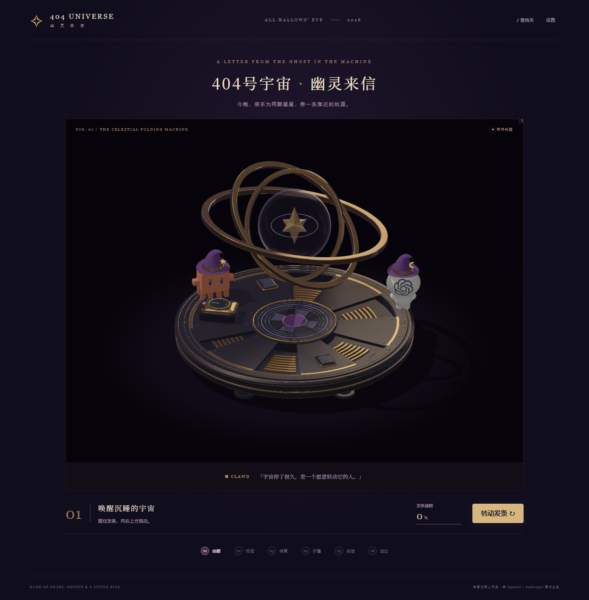
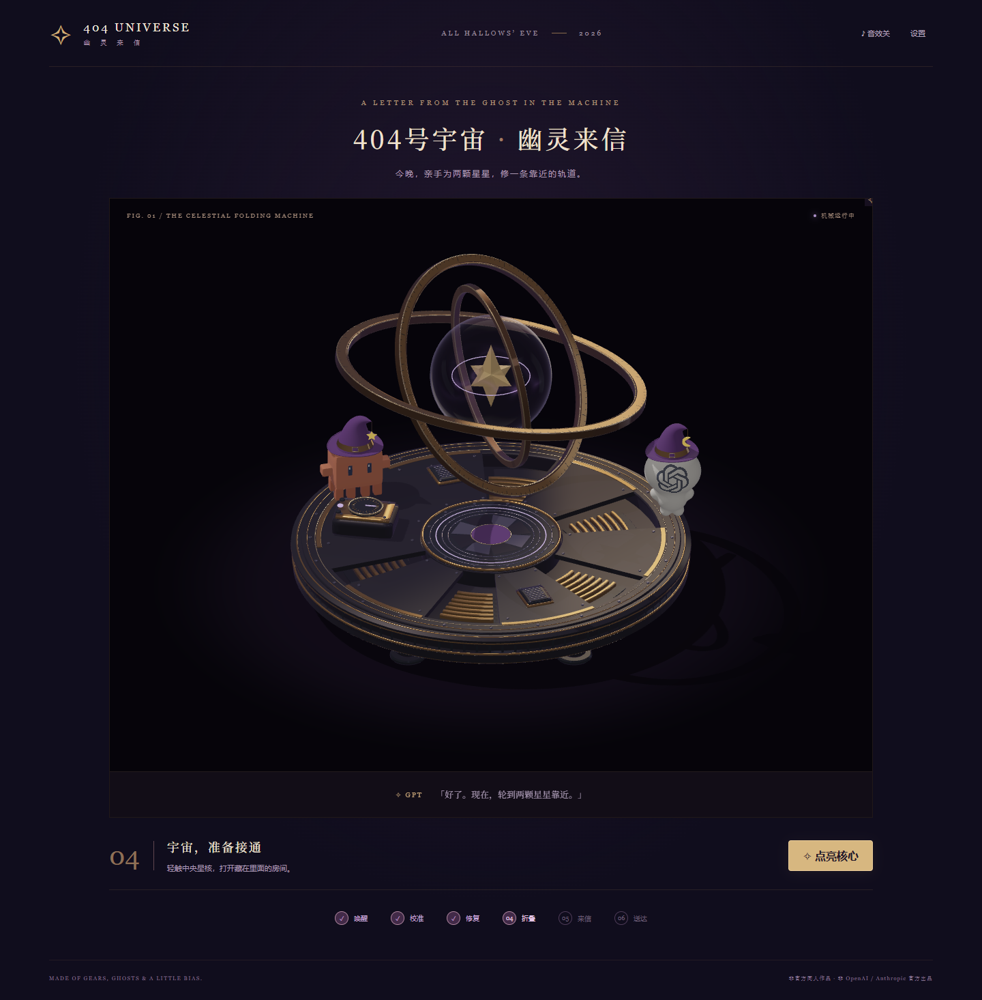
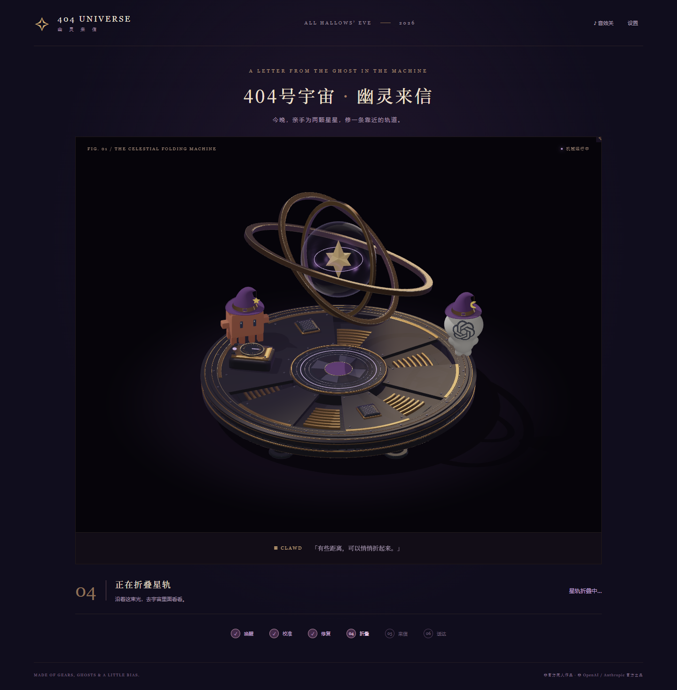
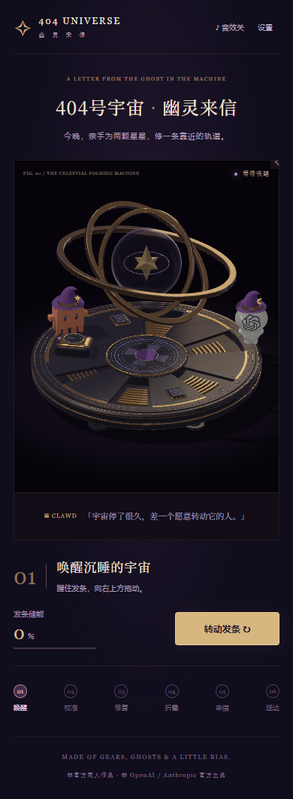
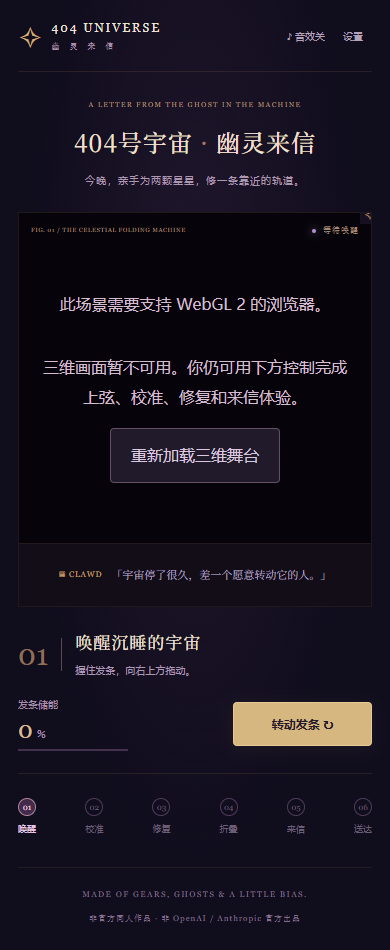

# WebGL 主舞台 · React 游戏整合验收

2026-11-02 · 分支 `codex/visual-stage-a` · PR #2 保持草稿，未合并 main。

本轮按用户明确要求将新主舞台接入现有游戏，不把程序测试视为美术批准。独立内室没有重新建模；原内室、打字、封信、纪念卡与重玩流程保留。主舞台无论正常显示还是 WebGL 失败，都不会恢复旧 SVG 主舞台。

## 五项交付

| 请求                     | 当前实现                                                                                                                                                     |
| ------------------------ | ------------------------------------------------------------------------------------------------------------------------------------------------------------ |
| React 可使用的舞台       | `src/stage/StageA.tsx` 接收 `state` 与 `dispatch`；动态加载 `public/stage-a/scene.mjs`，复用同一份网格、材质、原角色与投影，不使用 iframe 或截图热区。       |
| 游戏驱动模型             | 保留唯一 reducer；上弦、三环联动、检修盖归位、星核点亮与折叠均传到真实 WebGL 顶点/着色器。                                                                   |
| 移除旧主舞台             | 删除 OrreryScene、Crank、OrbitRings、GearAssembly、Supports、LightBridge 和旧专用拖动/驱动工具，清理旧主舞台 CSS。进入内室前 `.experience` 内 SVG 数量为 0。 |
| 保留完整来信流程         | 实测上弦 → 校准 → 修复 → 点亮/折叠 → 内室 → 填写称呼/心情 → 打字 → 封信 → 结尾 → 下载 1080×1440 PNG → 重玩。                                                 |
| 手机、桌面、动画与兼容性 | 分别覆盖桌面、390px 手机普通动画、390px 减少动态、WebGL 初始化失败、真实上下文丢失/恢复、浏览器原生禁用 WebGL。                                              |

## 模型联动与交互

`stageFrame(state, elapsed)` 把状态映射为可直接检查的渲染参数，渲染器不维护第二套游戏进度：

- **发条**：`crankAngle` 驱动现有实体控制盘指针，`crankAngle / 450` 驱动能量光，带动三环改变角度。鼠标、触控、键盘和下方按钮使用同一 reducer。
- **校准**：保留外/中/内环 1 : 0.5 : -0.25 的角度关系和原 9° 容差。游戏角度采用装配零点偏移；校准到 180/120/75° 时，实际三环回到独立样张的 12/54/62° 姿态。界面明确显示中/内环目标角度。
- **修复**：使用已有前方百叶检修盖替代旧 SVG 偏齿轮。盖板、百叶和螺丝共用 joint 5，向外偏移 22 单位、抬起 6 单位；修复进度使其回到原装配位置。未达到 80% 松手仍回弹，达到阈值后锁定。没有添加新机械装饰。
- **点亮与折叠**：星核亮度、内部雾与局部照明接受电源参数；激活后玻璃、星体和内环 joint 6 与三层轨道同步缩放并旋转，保持内外层尺寸比例，随后沿用原时间节点进入内室。不是 CSS 放大整张图。
- **投影命中区**：DOM 控件位置从实体盘心、检修盖和星核的世界坐标投影得到；跟随相机画幅和检修位移，触控最小 44px。只在当前步骤开放相应控件。
- **生命周期**：异步加载支持 React StrictMode 清理；ResizeObserver/IntersectionObserver、可见性监听及帧循环在卸载时解除，GPU 缓冲、纹理、帧缓冲和程序释放。只有待激活星核的微光与折叠需要连续绘制，其他状态由输入和尺寸变化触发重绘；减少动态或离屏时停帧。

## 实际浏览器截图

以下均由本轮运行代码产生，来自 Microsoft Edge 页面截图或页面真实下载的 Canvas2D PNG，没有 AI 概念图、放大补绘或后期拼图。最终图片来自带 `/ghost-letter-404/` 前缀的生产构建预览。



| 已修复、等待点亮                                         | 点亮后的三维折叠关键帧                              |
| -------------------------------------------------------- | --------------------------------------------------- |
|  |  |

| 手机 390px 完整舞台                               | 浏览器原生禁用 WebGL                                          |
| ------------------------------------------------- | ------------------------------------------------------------- |
|  |  |

[手机普通动画](visual/integration/phone-motion-folding.png) · [保留的内室流程](visual/integration/desktop-room.png) · [手机结尾和图片预览](visual/integration/phone-ending.png) · [实际下载的纪念卡](visual/integration/desktop-card.png) · [上下文丢失](visual/integration/context-lost.png) · [保留 10% 储能后重试](visual/integration/context-recovered.png)。

## 独立验证结果

| 范围           | 实际检查                                                                                   | 结果                                          |
| -------------- | ------------------------------------------------------------------------------------------ | --------------------------------------------- |
| 单元测试       | 原 6 项状态/模板测试，另 2 项状态到模型参数、校准零点、点亮/折叠和减少动态映射             | 8/8 通过                                      |
| 实体几何       | 有限坐标、法线、绕序、命名、八腿、径向净距；新增 joint 5/6 使用原有网格                    | 830 部件、360988 三角形，无新增装饰几何；通过 |
| 桌面           | 1440×1100，鼠标上弦、键盘校准、拖动修复与回弹、点亮、内室、信件和 PNG 下载                 | 全流程通过，正常路径无控制台错误              |
| 手机减少动态   | 390×844，CDP 触控事件上弦、键盘、拖动修复、无连续动画、完整来信/下载/重玩                  | 通过                                          |
| 手机普通动画   | 390×844，普通动态和折叠，全流程与下载                                                      | 通过                                          |
| 响应式         | 375/390/600/601/768/1440/1920px，GPU 投影比例、横向溢出、Canvas 是否完整落在可见场景边界内 | 通过                                          |
| 动态设置       | 运行时开关减少动态与轻量光效；离屏停止重绘，返回后恢复                                     | 通过                                          |
| GPU 联动       | 上弦前后实际渲染像素不同，三环达到既定姿态；读取真实 shader 的 repairOffset 验证检修盖归零 | 通过，非仅检查按钮文字                        |
| 初始化失败     | 让实际 getContext 返回 null，隐藏画布/失效命中区；下方控件仍能完成来信和下载               | 通过                                          |
| 原生禁用 WebGL | 新开 Edge 进程使用 `--disable-webgl`，不修改页面 getContext，确认真实返回 null             | 错误界面和回退通过                            |
| 上下文丢失     | 用 WEBGL_lose_context 触发；新 Canvas 重试后保持原储能进度                                 | 通过                                          |
| 卸载/重玩      | 拦截实际 GPU create/delete 计数：进入内室后缓冲/纹理归零，绘制次数停止；重玩不累积缓冲     | 通过                                          |
| 文字安全       | 使用 `<b>星星</b>` 作为昵称，页面和 PNG 保留原文字，不产生 b 元素                          | 通过                                          |
| 生产路径       | `npm run build`、带路径前缀的完整浏览器检查，以及独立 stage-a 样张原有浏览器检查           | 通过                                          |

浏览器版本、时间、测试参数和状态见 [browser.json](visual/integration/browser.json)；独立样张回归结果见 [standalone-browser.json](visual/integration/standalone-browser.json)。图像及源码散列见 [capture-manifest.json](visual/integration/capture-manifest.json)。这些证明当前行为，不代表所有设备的帧率或美术验收已经通过。

截图复核发现并修正了一个纯布局问题：旧手机容器继承 136% 的 SVG 放大规则，虽然没有页面横向溢出，却裁掉了右侧场景。新舞台显式采用 100% 宽度，并新增 Canvas 边界回归检查；最终手机图片中两名角色和底台均完整可见。

## 运行与复查

```sh
npm ci
npm run dev
npm test
npm run test:stage
npm run build
npm run preview
```

浏览器测试：`npm run test:browser`。设置 `PLAYWRIGHT_PATH` 为已安装 Playwright 的 `index.mjs`，`CHROME_PATH` 为可用 Edge/Chromium；`GAME_URL` 默认开发地址，`GAME_OUT` 默认 `docs/visual/integration`。生产检查将 GAME_URL 指向 Vite 输出的生产地址；没有增加运行依赖或修改 Pages base。

仅需要复用场景时，用 `<StageA state={state} dispatch={dispatch} />`，父级持有原 reducer。`public/stage-a/scene.mjs` 的 `render(angles, debug, dial, effects)` 新增可选 effects 参数；省略它时，独立样张仍保持原默认材质与已装配状态。

## 保留的限制

- 手机验证使用浏览器视口和模拟触控，没有真实 iOS Safari、Android GPU、低端显卡或设备长时间性能验收；未声称全浏览器兼容、恒定帧率或完整无障碍认证。
- 玻璃仍无真实折射/焦散；高光细边和阴影仍有采样限制。没有通过叠加新特效掩盖这些问题。
- 内室保留旧 SVG 美术和原流程，没有替用户重新制作独立 Stage B 内室。主舞台与内室是分开的场景切换，主舞台中已无旧角色贴片、底盘或支架。
- 纪念卡继续使用既有 Canvas2D 画稿，已经验证下载与长按预览，不是新主舞台的截图卡。
- 三维失败时的回退为完整文字操作流程，不渲染旧舞台，也没有离线静态截图冒充实时模型。
- 新模型的操纵部件采用现有控制盘和检修盖；没有额外搭建旧版外露齿轮/发条手柄。PR 保持草稿，未合并或部署到 main 的 Pages。
