# Stage A · 视觉验收准备

更新：2026-11-02（Asia/Shanghai）。分支：`codex/visual-stage-a`；PR：[#2](https://github.com/Qisi3344/ghost-letter-404/pull/2)。

**本页为独立静态舞台的历史验收记录，图像与源码散列对应提交 b7a5dba，未自行判定美术通过。** 用户随后明确要求将主舞台接入现有游戏；当前整合结果、截图与验证见 [INTEGRATION_REVIEW.md](INTEGRATION_REVIEW.md)。新内室建模未启动，PR 保持草稿，不合并或修改 main。

开始时开发分支缺少两份约束文件，已只读核对 [AGENTS.md](https://github.com/Qisi3344/ghost-letter-404/blob/36894b698d8582b751578b37ebac39236924892d/AGENTS.md) 和 [VISUAL_ACCEPTANCE.md](https://github.com/Qisi3344/ghost-letter-404/blob/36894b698d8582b751578b37ebac39236924892d/docs/VISUAL_ACCEPTANCE.md)，没有通过合并 main 引入其他开发内容。

## 本轮改善了什么

### 补充：三个独立装置的径向装配

按现有金色 T 型刻槽对应的面板扇区中线统一装配规则：装置本地长轴沿径向，短轴沿切向；控制盘为 **145°**，前方百叶装置为 **25°**，后方百叶装置为 **205°**（世界 XY 平面角度，不是屏幕旋转角度）。两块百叶相隔 180°，形成中心对称关系。

三个装置的中心保留原距底盘中心的半径，仅沿圆周移至所在扇区中线；高度、尺寸、形体及材质保持不变。面板、百叶、螺丝、按钮和指针作为整体旋转，控制盘交互命中区与真实盘心同步。现有刻槽和面板采用同一组扇区参数，避免各自维护角度产生偏差。

本次布局修订基于提交 a108c56；下方当前截图和来源散列已更新。三姿态、390 px 视口及控制盘鼠标/触控/键盘检查再次通过。

1. **金属结构**：三环保持原半径 151 / 120 / 91、截面宽 12 / 10 / 8、厚 9 / 8 / 7。将环面、倒角及内外侧壁分配不同表面工艺；原来凸起的黑色圆管式“槽”改为环截面内深 0.3 单位的连续 V 槽。没有增加支撑件或装饰物。
2. **金属反射**：原反射主要来自顶灯，近竖直环面经常成为均匀棕色。现在加入有限尺寸的竖向暖色与冷色反射卡，和顶灯一起按世界位置及反射方向计算；底台、控制盘和环体共用同一环境。侧壁更暗、倒角更亮，取代整块同色的读感。
3. **玻璃空间**：球面从 48 增至 64 个纬向采样；引入外半径 61、内腔半径 59.4 的解析壳层光程近似，并降低内部雾对星体的覆盖。玻璃和金属反射同一组光源，内星、细环、玻璃前后表面及外部轨道仍共同接受深度测试。
4. **角色与帽子**：保留月汐小岛原版身体网格、Clawd 八腿/双钳/蓝眼、GPT 连续曲面/结形标志/短手与下摆。两顶帽子沿弯曲中心线的切向重新放置截面，避免末端截面一直水平造成挤压；帽布改为低反射粗糙材质。帽带薄弧扣、金星/月牙及世界竖直吊绳保留。
5. **阴影与细纹**：阴影深度绘制加入斜率偏移，减少表面自阴影暗块；细金属纹理按像素导数过滤，避免超出屏幕采样频率的纹理制造摩尔纹。细亮边和阴影采样仍有局限，见下文。
6. **无法渲染时**：初始化失败及运行中 WebGL 上下文丢失都会显示可由键盘访问的重试入口，隐藏黑画布、失效控制盘与姿态链接；上下文丢失时停止帧循环及后续重绘。`?webgl=off` 仅用于人工复查错误界面，不是静态图片替代舞台。

## 当前真实浏览器画面

全部图像来自本轮运行代码。桌面、姿态、手机和失败状态为 Microsoft Edge 实际页面/Canvas 截图；4× 特写为 Codex 内置 Chromium 浏览器的原生 WebGL 缓冲区导出，仅做等像素裁切，没有放大、补绘、AI 生成或后期修饰。

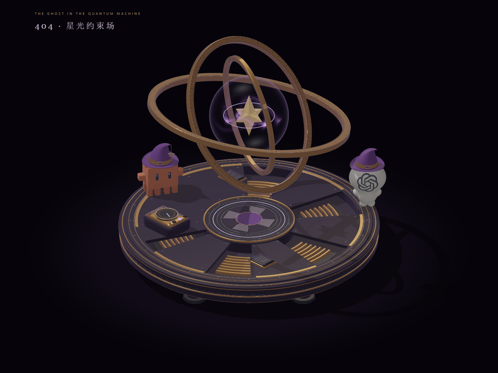

| 本轮开始前，提交 32ecde2                               | 当前相同逻辑裁切区域，4×                           |
| ------------------------------------------------------ | -------------------------------------------------- |
| 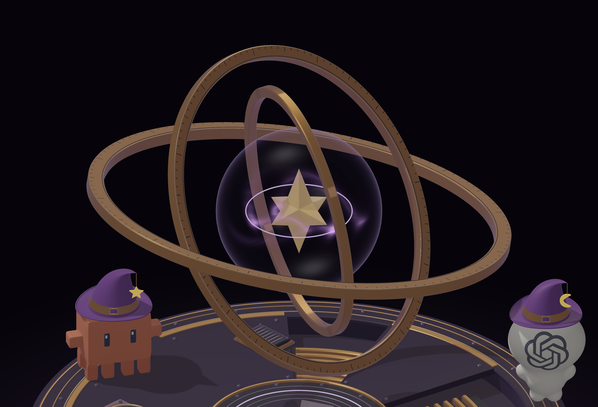 | 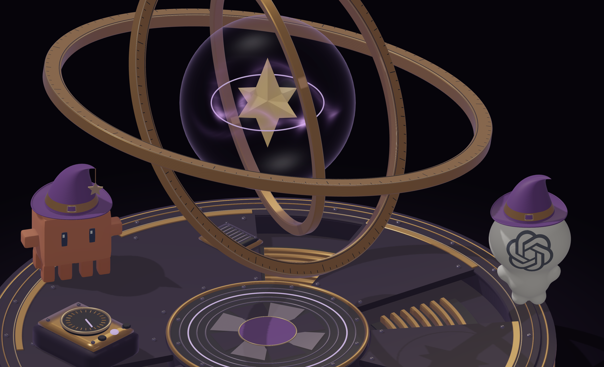 |

| 玻璃与内星 4×                                 | 底台与控制盘 4×                                |
| --------------------------------------------- | ---------------------------------------------- |
| 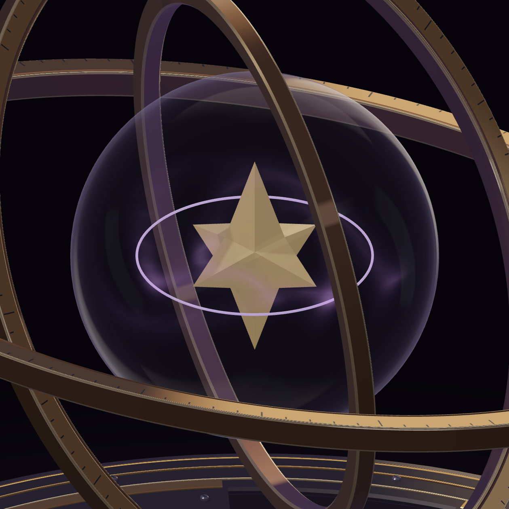 | 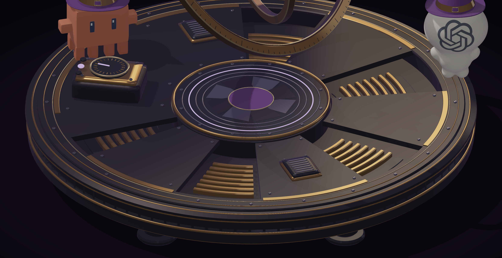 |

| Clawd 4×                                               | GPT 4×                                         |
| ------------------------------------------------------ | ---------------------------------------------- |
| 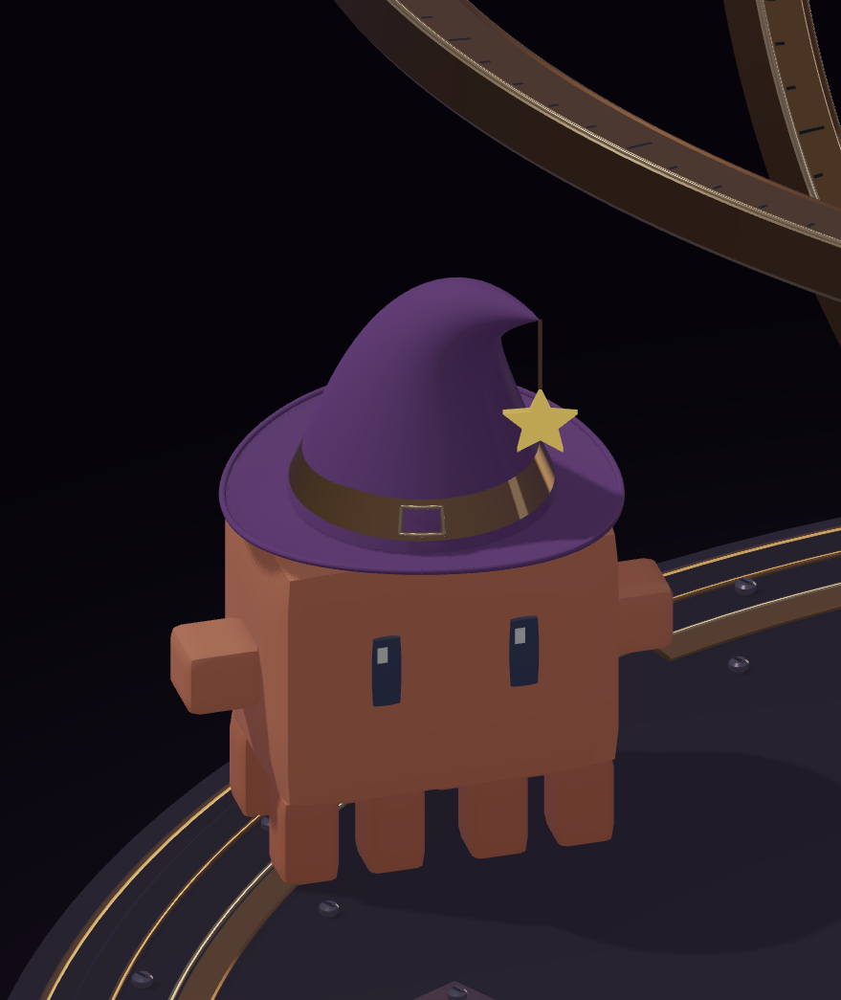 | 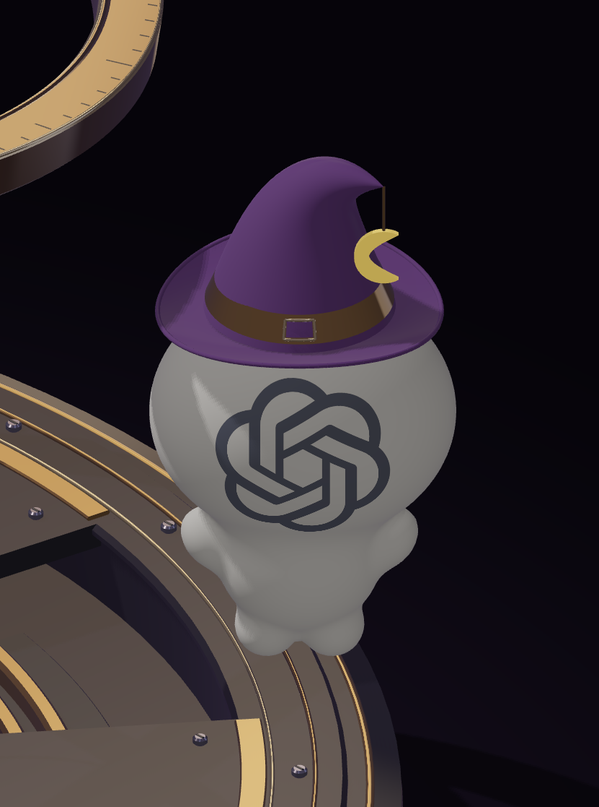 |

| 姿态 B：-18 / 82 / 38°               | 姿态 C：30 / 30 / 105°               |
| ------------------------------------ | ------------------------------------ |
| 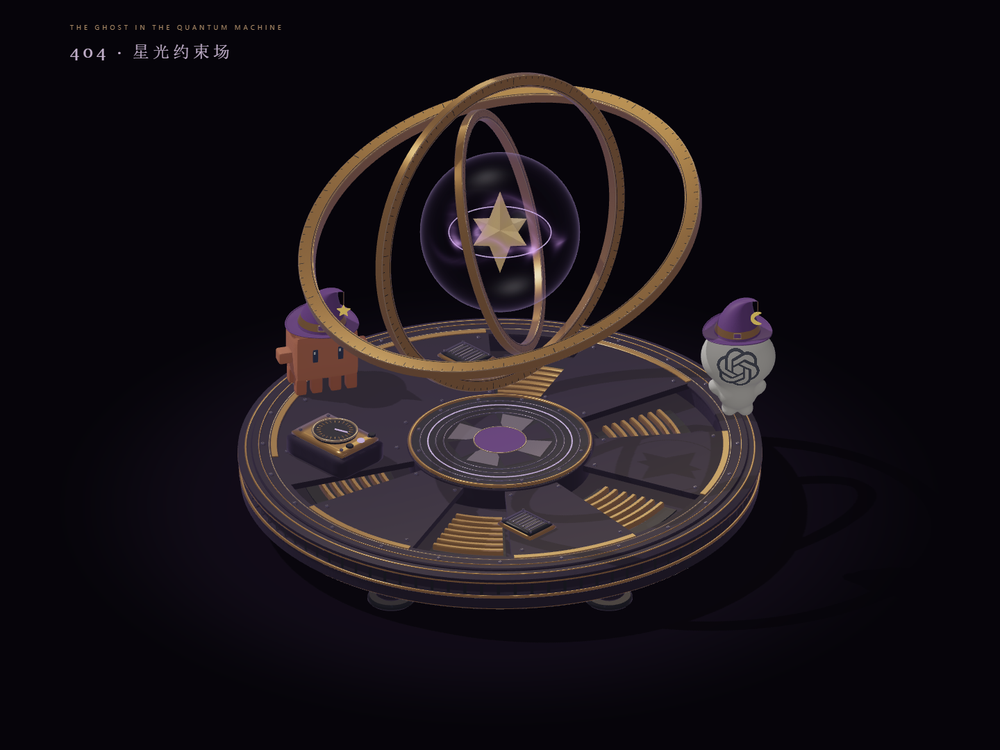 | 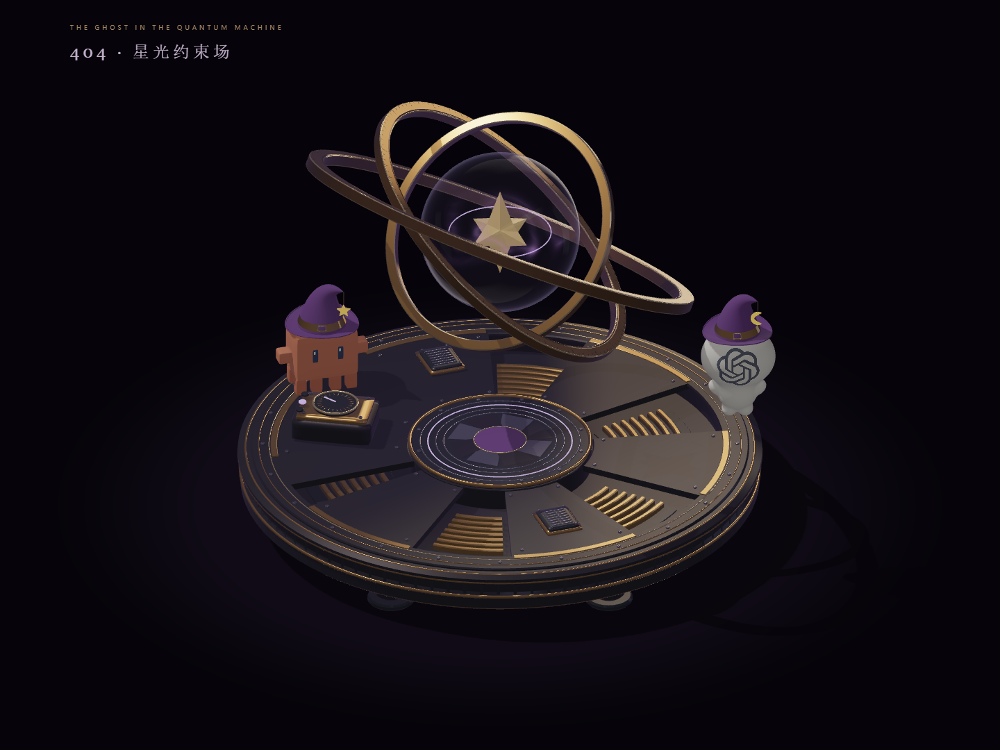 |

| 390 × 844 手机视口                                | WebGL 2 不可用，键盘焦点在重试入口                    |
| ------------------------------------------------- | ----------------------------------------------------- |
| 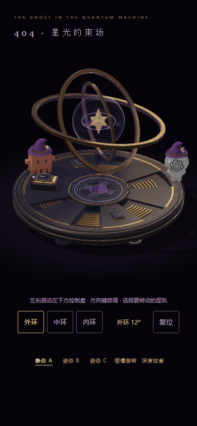 | 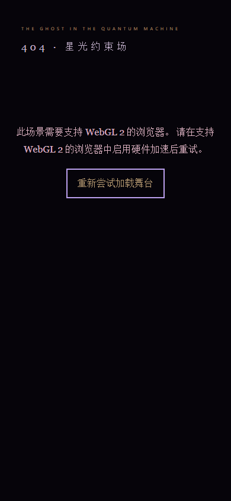 |

[深度检查](visual/stage-a/main-stage-depth-check.png) · [鼠标操作后（外环 72°）](visual/stage-a/controls-desktop.png) · [运行中上下文丢失](visual/stage-a/webgl-context-lost.png) · [修改前完整页面](visual/stage-a-review/00-before.jpg)。

## 逐项复核记录

这里的“已检查”表示完成相应取证，不代表美术验收通过。

| 步骤 | 对象与证据                        | 结果及限制                                                                                                                                                         |
| ---- | --------------------------------- | ------------------------------------------------------------------------------------------------------------------------------------------------------------------ |
| 1    | 桌面 1× 全景                      | 三环可数，主体、双角色、底台和控制盘共用同一相机；没有可见支柱、轴承帽、连接节点或旧游戏页面拼接。整体依然是风格化硬表面建模，是否足够精致由用户判断。             |
| 2    | 金属/玻璃 4×                      | 可检查实体侧壁、倒角、下切槽、刻度、玻璃边缘、内部星体及远近遮挡。极细高光线仍可见像素台阶，玻璃不是物理路径追踪。                                                 |
| 3    | Clawd/GPT 4×                      | 原版比例和识别形状保留；两者接受相同灯光、阴影与深度。帽饰贴合已复核，身体不重建；八腿由几何清单确认，固定视角无法同时看到全部八腿。                               |
| 4    | A/B/C 三姿态、深度图及控制后姿态  | 已查看不同交叉关系和明暗，没有在这些采样画面发现环间穿模、断开的几何缝隙或颠倒的实体遮挡。B 姿态的环在投影上遮住 Clawd 帽沿，几何上彼此分离。                      |
| 5    | 缓慢旋转、减少动态效果            | 自动旋转确实推进；减少动态效果或手动接管后停止连续重绘。采样及径向分离检查不等于任意角度逐帧人工验收，不能保证所有设备上完全无细线闪烁。                           |
| 6    | 390 px 手机及 600/601/768 px 边界 | 无横向溢出，画幅比例正确，控制盘命中区至少 44 px。390 px 下刻纹很小，工艺判断仍须看桌面特写；未测真实手机。                                                        |
| 7    | 控制盘鼠标、触控、键盘            | 实际鼠标拖动、CDP 触控事件、方向键、复位、角度回绕和自动巡游接管通过；测试还检查了渲染像素随操作改变。触控属于浏览器模拟。                                         |
| 8    | WebGL 失败及恢复                  | 在页面启动前让实际 getContext 返回 null，确认失败处理；通过 WEBGL_lose_context 触发真正的上下文丢失，确认停帧；演示入口的重试能回到正常渲染。不是无 GPU 真机认证。 |

## 几何、构建与浏览器验证

- 当前为 **830 个命名部件、360988 个三角形**。部件数增加来自同一环体表面工艺的分组，不是堆叠装饰；[组件清单](visual/stage-a/components.json)。
- 有限坐标、单位法线、绕序、唯一命名、八腿、吊绳方向及旋转保持长度检查通过；没有反向三角形。
- 三个径向净距约为 **20.006 / 20.006 / 26.042**；外环最远半径 157.044。Clawd / GPT 三角形保守包围球到星核中心的下界为 170.379 / 176.112，因此角色不进入三环完整旋转扫掠范围。这个结论不代替全场景所有零件的碰撞检测。
- `npm test`：6/6 通过；`npm run build`：通过；`git diff --check`：通过。
- `node scripts/browser-stage-a.mjs`：通过；Edge **156.0.4314.58**。正常舞台路径无浏览器报错，预期的 WebGL 初始化错误单独测试。
- 带 `/ghost-letter-404/` 前缀的生产预览再次通过同一浏览器检查；[静态预览记录](visual/stage-a/browser.json)、[生产预览记录](visual/stage-a/browser-production.json)。提交次数、CPU 提交耗时均不代表实际 GPU 帧率。
- 内置浏览器整页截图接口在末次补拍时失败；最终全景、姿态、手机与失败状态采用已成功保存并打开检查的 Edge PNG。4× 导出正常，未把失败截图作为证据。

## 仍未解决或尚未验证

1. **玻璃仍是近似渲染。** 1.6 单位厚度是解析光程模型，不是新增独立内壳网格。没有真实折射、色散、焦散、物体间互反射或完整体积透射阴影；后方轨道不会因穿过玻璃而真实弯折。
2. **4× 下的细线与阴影还不完美。** 2048² PCF 阴影和极窄卷边仍有采样痕迹；过滤金属细纹不能完全消除所有旋转高光/刻度闪烁。未做时间抗锯齿或全角度逐帧验收。
3. **整体仍偏风格化、洁净。** 环面较规则、磨损很克制，角色保持原版简洁形体，未达到电影级雕塑与材质复杂度。没有为掩盖这些差距追加粒子、齿轮或装饰。
4. **设备覆盖有限。** 已测桌面 Chromium/Edge、模拟手机尺寸及触控；未测真实 iOS Safari、Android GPU、低端显卡、屏幕阅读器或真实无 WebGL 设备，未声称完整无障碍合规。
5. **阶段边界保持。** 没有进内室的折叠转场、角色动作或旧状态机接入；Stage B/C 属于后续关卡，当前不开发。Stage A 只有用户明确认可后才能通过。

## 复现与取证

```sh
npm ci
npm run dev
# /ghost-letter-404/stage-a/index.html
node scripts/check-stage-a.mjs
npm test
npm run build
```

浏览器脚本使用 `PLAYWRIGHT_PATH` 指向已安装的 Playwright `index.mjs`，`CHROME_PATH` 可指定 Edge/Chromium，`STAGE_URL` 可指定生产预览，`STAGE_OUT` 可分开保存测试产物。无新增运行依赖。

4× 复现：桌面视口 **1440 × 1250** 打开 `?capture=1`，使用页面底部的验收导出按钮。该模式不改变模型，只将同一场景重渲染至 4 像素/CSS px。由于页面出现滚动条，本轮实际 Canvas 为 **1425 × 1069 CSS px**，原始缓冲为 **5700 × 4276**；金属/玻璃裁切输出 **3278 × 2233**，不是将 1× 图片放大。

图像尺寸、SHA-256、运行源码散列及裁切来源保存在 [capture-manifest.json](visual/stage-a/capture-manifest.json)。源码散列统一按 LF 换行计算。4× 图均已打开检查；截图为当前运行版本，不使用仓库早期截图替代本轮证据。

原模型来源、授权和生成方式仍见 [MOONTIDE_MODELS.md](MOONTIDE_MODELS.md)。Anatomy MIT kit、原角色与许可证保持原样。
